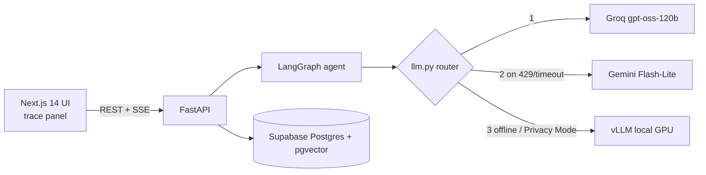

# <Project name>

> <one-line pitch>



## Quickstart
```bash
cp .env.example .env              # fill keys
cd backend && uv sync && cd ..
cd frontend && npm ci && cd ..
bash scripts/dev.sh               # API :8787, UI :3000
bash scripts/smoke_demo.sh
```

## Env vars
`GROQ_API_KEY`, `GEMINI_API_KEY`, `VLLM_BASE_URL`, `VLLM_MODEL`, `PRIVACY_MODE`,
`SUPABASE_URL`, `SUPABASE_ANON_KEY`, `NEXT_PUBLIC_API_URL`, `CORS_ORIGINS`

## Rubric alignment
| Criterion | Where to see it |
|---|---|
| <criterion> | <screen / demo second> |

## Works offline
Toggle **Privacy Mode**: every model call goes to a local vLLM server on the presenter's GPU.

## AI disclosure
See [AI_DISCLOSURE.md](AI_DISCLOSURE.md).
