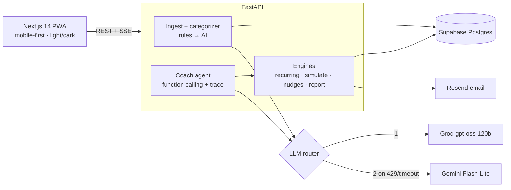

# FinPulse

> A mobile-first finance coach that turns messy bank SMS and statements into a living money model. It learns
> from your corrections, catches subscription creep, and shows "what if" in real rupees.

**Live demo:** https://finpulse-sandy-five.vercel.app · **API:** https://finpulse-x2b7.onrender.com/health · **Video:** TODO

> The API runs on Render's free tier and sleeps when idle: the first request can take ~50 s.

## Problem
Salaried users in India get money data as hundreds of bank/UPI SMS, password-protected PDFs and CSV exports with
different headers. Budgeting apps either need bank logins or make you tag everything by hand, and "AI coaches"
make up numbers or push products.

## Solution
- Paste SMS or upload CSV/PDF; FinPulse parses, normalizes merchants and categorizes (rules first, then AI).
- Fix a category once: it learns a rule and offers to apply it to similar past transactions.
- Detects recurring payments; alerts on price changes (Netflix 499 → 649) and unused subscriptions.
- Profile + goals with target dates; a what-if simulator ("cut dining 30%", "rent +2,000").
- A coach agent with a live tool-call trace. Every rupee figure is computed in Python, not by the LLM.
- Drift nudges in-app and by email, plus a monthly review report. Installable PWA with light/dark mode.

## Architecture


## Setup
```bash
cp .env.example .env                   # fill keys (names below)
cd backend && uv sync && cd ..
cd frontend && npm ci && cd ..
# apply supabase/migrations/0001_init.sql in the Supabase SQL editor (or `supabase db push`)
cd backend && uv run python ../scripts/make_samples.py && cd ..   # demo files -> backend/samples/
bash scripts/dev.sh                    # API :8787, UI :3000
bash scripts/smoke_demo.sh
```

### Env vars
`GROQ_API_KEY`, `GEMINI_API_KEY`, `SUPABASE_URL`, `SUPABASE_SERVICE_KEY`, `RESEND_API_KEY`, `EMAIL_FROM`,
`DEMO_EMAIL`, `CORS_ORIGINS`, `NEXT_PUBLIC_API_URL` (unused here: `VLLM_BASE_URL`, `VLLM_MODEL`, `PRIVACY_MODE`).

> **Security note:** single-user demo with no login. RLS is **enabled with no policies**, so the public anon key can
> read nothing; only the FastAPI server (Supabase service key, server-side only) touches data. A multi-user
> version would add Supabase Auth and per-user RLS policies.

## Features vs PS4
| # | PS4 requirement | FinPulse | Status |
|---|---|---|---|
| 1 | Ingest messy statements (PDF, CSV, SMS) + auto-categorize | SMS + CSV + PDF parsers, rules → AI categorizer, auto-rate chart | TODO |
| 2 | Correction loop that learns rules | Correct → rule learned → retro-apply to similar | TODO |
| 3 | Recurring/subscription detection + change/unused alerts | active / changed / unused badges | TODO |
| 4 | Persistent profile: income, fixed costs, emergency fund, goals | Plan tab | TODO |
| 5 | Goal planner with what-if simulation | `/simulate`, baseline vs scenario goal dates | TODO |
| 6 | Nudges when spending drifts | In-app drift nudges | TODO |
| 7 | Monthly review report | Report tab | TODO |
| 8 | Guardrail: no specific securities | Intent pre-check → refusal + education | TODO |
| + | Email nudges + report | Resend, button-triggered | TODO |
| + | Installable PWA, mobile-first, light/dark | manifest + service worker | Shell done |
| + | Essentials never suggested as cuts | Essentials rule in coach + simulator | TODO |
| + | Transparent agent | Live tool-call trace (tier, ms, args, result) | TODO |

## Guardrails
- **No securities advice:** an intent check runs before the agent. Stock, fund or crypto pick requests get a
  refusal plus general education.
- **Essentials are protected:** Rent, Utilities, Groceries, Medical, EMI, Insurance and Education are never
  suggested as cuts. If essentials exceed income, the coach says so and points to income or a human advisor.
- **No LLM arithmetic:** every number comes from Python engines; the LLM only explains them.

## AI disclosure
See [AI_DISCLOSURE.md](AI_DISCLOSURE.md).
